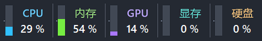

# 硬件脉搏 · Hardware Pulse

[English](README_en-us.md)

硬件脉搏是一款轻量的 Windows 桌面硬件看板。在一行悬浮窗里查看 **CPU、内存、GPU、独立显存和硬盘活动率**。默认的 12 号皮肤用鲜艳的竖条显示负载，同时保留实时百分比。每根竖条的中点刻线代表 50%。



## 下载和使用

从 [Releases](https://github.com/xiaohang007/hardware-pulse/releases/latest) 下载 `HardwarePulse-x64.zip`，完整解压后运行 `HardwarePulse.exe`。首次启动就会显示 12 号皮肤的五格布局。右键点击悬浮窗可切换到 11 号纯数字皮肤。

显存显示有可用读数的显卡的独立显存使用百分比。无法采集时显示 `--`。硬盘百分比表示活动率。原有的网速监控、任务栏显示和插件功能仍可在相应设置中使用。

发布包为 Windows x64 Lite 版。如果启动时提示缺少运行库，请安装微软的 [Visual C++ x64 可再发行组件](https://aka.ms/vs/17/release/vc_redist.x64.exe)。

## 从源码构建

使用 Visual Studio 2022 Build Tools，安装 MSVC v143 x64/x86、C++ MFC 和 Windows SDK。然后在开发者命令行运行：

```powershell
msbuild TrafficMonitor_Lite.sln -t:TrafficMonitor -m -p:Configuration="Release (lite)" -p:Platform=x64 -p:PlatformToolset=v143
python scripts/package.py
```

便携包生成在 `Bin/HardwarePulse-x64.zip`。

## 上游项目与许可

硬件脉搏基于 [TrafficMonitor](https://github.com/zhongyang219/TrafficMonitor) 开发，感谢 zhongyang219 和所有上游贡献者。上游的使用说明见 [TrafficMonitor Wiki](https://github.com/zhongyang219/TrafficMonitor/wiki)。本项目保留上游版权声明和 [许可证](LICENSE)。
