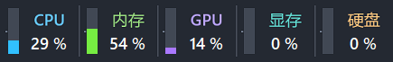

# Hardware Pulse

[简体中文](README.md)

Hardware Pulse is a compact Windows desktop dashboard for **CPU, memory, GPU, dedicated video memory, and disk activity**. Skin 12 is the default. Its vivid vertical bars make loads easy to compare, and the live percentages show the exact readings. The tick beside each bar marks 50%.



## Download and use

Download `HardwarePulse-x64.zip` from [Releases](https://github.com/xiaohang007/hardware-pulse/releases/latest). Extract the whole archive and run `HardwarePulse.exe`. The five-metric dashboard opens on first launch. Right-click the floating window to switch to Skin 11 for a numbers-only view.

Video memory shows the percentage of dedicated memory used across GPUs with available readings. Unavailable readings appear as `--`. The disk percentage measures activity. Network monitoring, the taskbar display, and plugins remain available in settings.

The portable release is the Windows x64 Lite build. If Windows reports a missing runtime, install the Microsoft [Visual C++ x64 Redistributable](https://aka.ms/vs/17/release/vc_redist.x64.exe).

## Build from source

Install Visual Studio 2022 Build Tools with MSVC v143 x64/x86, C++ MFC, and the Windows SDK. Run these commands from a developer shell:

```powershell
msbuild TrafficMonitor_Lite.sln -t:TrafficMonitor -m -p:Configuration="Release (lite)" -p:Platform=x64 -p:PlatformToolset=v143
python scripts/package.py
```

The resulting archive is `Bin/HardwarePulse-x64.zip`.

## Credits and license

Hardware Pulse is based on [TrafficMonitor](https://github.com/zhongyang219/TrafficMonitor). Thanks to zhongyang219 and the upstream contributors. See the [TrafficMonitor Wiki](https://github.com/zhongyang219/TrafficMonitor/wiki) for upstream documentation. The original copyright notice and [license](LICENSE) are included.
